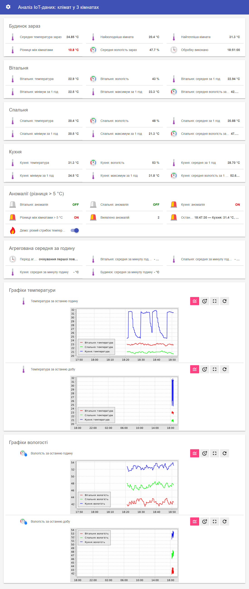
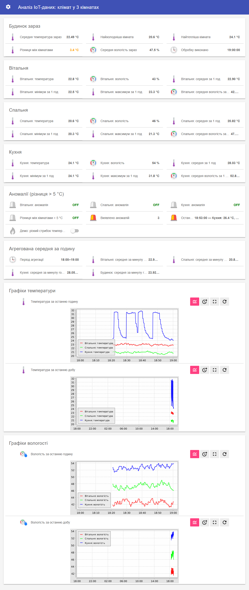

# IOTPR7 — Обробка та аналіз IoT-даних в openHAB

Практична робота 7. Система для трьох кімнат (вітальня, спальня, кухня):

- **віртуальні датчики** температури й вологості (по одному на кімнату) — нове значення кожні 30 с;
- **RRD4j Persistence**: автоматичне збереження всіх показників у локальну базу `userdata/persistence/rrd4j/*.rrd`;
- **правила обробки**: середнє, мінімум/максимум, агрегована середня за годину, детекція аномалій (різниця > 5 °C);
- **sitemap** українською з графіками температури й вологості за годину та добу.

Стек: Docker, openHAB 4.2.2, DSL-правила, Basic UI. Інтернет потрібен лише при першому запуску (openHAB завантажує доповнення).

## Запуск

```bash
docker compose up -d
```

Через 1–2 хв відкрити Basic UI: <http://localhost:8083/basicui/app?sitemap=climate>

Перевірити значення без браузера:

```bash
bash scripts/check.sh
```

> На Windows зміни у файлах `openhab/conf` не завжди підхоплюються автоматично (Docker не передає події файлової системи), тому після редагування правил виконайте `docker compose restart`.

## Структура

```
IOTPR7/
├── docker-compose.yml                    # openHAB 4.2.2, порт 8083
├── openhab/conf/
│   ├── services/addons.cfg               # встановлення RRD4j та Basic UI
│   ├── services/runtime.cfg              # мова uk, persistence за замовчуванням = rrd4j
│   ├── persistence/rrd4j.persist         # що і як часто зберігати
│   ├── items/climate.items               # датчики, результати обробки, аномалії
│   ├── rules/sensors.rules               # віртуальні датчики
│   ├── rules/processing.rules            # правила обробки
│   └── sitemaps/climate.sitemap          # інтерфейс і графіки
├── scripts/check.sh                      # стан системи через REST API, демо аномалії
└── docs/screenshots/                     # знімки інтерфейсу
```

## 1. Встановлення RRD4j Persistence

[`addons.cfg`](openhab/conf/services/addons.cfg) встановлює доповнення під час старту, а [`runtime.cfg`](openhab/conf/services/runtime.cfg) робить RRD4j службою за замовчуванням:

```ini
ui = basic
persistence = rrd4j
```
```ini
org.openhab.persistence:default=rrd4j
```

Після запуску в контейнері з'являються файли бази — по одному `.rrd` на кожен збережений item:

```
$ docker exec iotpr7-openhab ls /openhab/userdata/persistence/rrd4j
Anomaly_Bedroom.rrd  Anomaly_Count.rrd  ...  Temp_Kitchen.rrd  Temp_Living.rrd  ...
```

RRD4j — кругова база (round-robin): розмір файлу фіксований, а старі дані автоматично агрегуються (хвилини → години → дні), тому база не росте безмежно. Це добре підходить для IoT-датчиків на слабкому сервері.

## 2. Віртуальні датчики (3 кімнати)

[`climate.items`](openhab/conf/items/climate.items) — 6 items у групах `gTemp` і `gHum`:

| Кімната | Температура | Вологість | Базове значення |
| --- | --- | --- | --- |
| Вітальня | `Temp_Living` | `Hum_Living` | 22 °C, 45 % |
| Спальня | `Temp_Bedroom` | `Hum_Bedroom` | 20 °C, 50 % |
| Кухня | `Temp_Kitchen` | `Hum_Kitchen` | 23,5 °C, 55 % |

Правило [`sensors.rules`](openhab/conf/rules/sensors.rules) кожні 30 с формує нове значення так, щоб воно було схоже на справжній датчик:

```
ціль   = базове + 1,5 · sin(добовий цикл)          // тепліше вдень, холодніше вночі
нове   = поточне + 0,25 · (ціль − поточне) + шум    // плавна зміна, шум ±0,2 °C
```

Перемикач `Demo_Anomaly` імітує різкий стрибок на кухні (+7 °C, наприклад, увімкнена плита) — для перевірки детекції аномалій.

## 3. Автоматичне збереження в RRD4j

[`rrd4j.persist`](openhab/conf/persistence/rrd4j.persist):

```
Strategies {
    everyMinute : "0 * * * * ?"
    default = everyChange
}
Items {
    gTemp*, gHum*       : strategy = everyChange, everyMinute, restoreOnStartup
    gStats*, gHourAgg*  : strategy = everyChange, everyMinute, restoreOnStartup
    gAnomaly*           : strategy = everyChange, everyMinute, restoreOnStartup
    Anomaly_Count       : strategy = everyChange, restoreOnStartup
}
```

- `everyChange` — запис при кожній зміні значення;
- `everyMinute` — обов'язковий для RRD4j: база має крок 1 хв, і без регулярного запису на графіках були б пропуски;
- `restoreOnStartup` — після перезапуску openHAB відновлює останні значення з бази (це видно в журналі: після `docker compose restart` датчики продовжують з тих самих значень, а не з `NULL`).

## 4. Правила обробки

Усі правила — у [`processing.rules`](openhab/conf/rules/processing.rules). Обчислення беруть дані з бази RRD4j через persistence-методи openHAB.

| Що обчислюється | Як | Коли | Items |
| --- | --- | --- | --- |
| **Середнє** по кімнаті за останню годину | `averageSince(now.minusHours(1), "rrd4j")` | щохвилини | `Temp_*_Avg1h`, `Hum_*_Avg1h` |
| **Мінімум / максимум** за останню годину | `minimumSince(...)`, `maximumSince(...)` | щохвилини | `Temp_*_Min1h`, `Temp_*_Max1h` |
| **Середнє / мін / макс по будинку** зараз | обхід членів групи `gTemp` | при кожній зміні датчика | `House_Temp_Avg/Min/Max/Spread`, `House_Hum_Avg` |
| **Агрегована середня за годину** | `averageSince(now.minusHours(1))` → знімок | о хх:00:05 щогодини | `Temp_*_HourAgg`, `House_Temp_HourAgg`, `HourAgg_Period` |
| **Аномалія в кімнаті** | \|поточне − середня за 1 год (без останніх 5 хв)\| > 5 °C **або** \|поточне − значення 5 хв тому\| > 5 °C | при кожній зміні датчика | `Anomaly_Living/Bedroom/Kitchen` |
| **Аномалія між кімнатами** | найтепліша − найхолодніша кімната > 5 °C | при кожній зміні датчика | `Anomaly_Spread` |

При виявленні аномалії правило вмикає прапорець, збільшує `Anomaly_Count`, записує опис у `Anomaly_Last` і пише попередження в журнал (`logWarn`). Коли значення повертається в норму, прапорець скидається.

**Чому база без останніх 5 хвилин.** Перша версія порівнювала поточне значення зі звичайною середньою за годину. На практиці при стрибку кухні до 31 °C аномалія зникала вже за хвилину: доки історія коротка, стрибок одразу підтягує середню за собою (кухня: середня 24,5 → 28,5 °C за 2 хв). Тому базою стала середня за годину без останніх 5 хвилин, а для різких стрибків додано друге порівняння — зі значенням 5 хвилин тому.

Агреговані значення (`gHourAgg`) теж зберігаються в RRD4j, тож їх можна будувати на графіку й порівнювати години між собою.

## 5. Sitemap і графіки

[`climate.sitemap`](openhab/conf/sitemaps/climate.sitemap) — блоки «Будинок зараз», окремо по кожній кімнаті, «Аномалії», «Агрегована середня за годину» та графіки:

```
Chart item=gTemp period=h service="rrd4j" legend=true label="Температура за останню годину"
Chart item=gTemp period=D service="rrd4j" legend=true label="Температура за останню добу"
Chart item=gHum  period=h ...
Chart item=gHum  period=D ...
```

Графік групи автоматично показує всі три кімнати різними кольорами з легендою.

## 6. Перевірка роботи системи

Перевірка 13.11.2026 з 18:20 до 19:00. Повні виводи — у теці [`results/`](results).

**RRD4j зберігає дані.** У базі 28 файлів `.rrd`, по одному на кожен збережений item ([`results/rrd4j_files.txt`](results/rrd4j_files.txt)). Після `docker compose restart` значення датчиків відновилися з бази й не були `NULL`.

**Обробка працює** ([`results/check_after_hour.txt`](results/check_after_hour.txt)):

| Кімната | Зараз | Середня за 1 год | Мін за 1 год | Макс за 1 год |
| --- | --- | --- | --- | --- |
| Вітальня | 22,9 °C | 22,94 °C | 22,5 °C | 23,3 °C |
| Спальня | 20,4 °C | 20,88 °C | 20,5 °C | 21,3 °C |
| Кухня (з демо-стрибком) | 31,3 °C | 28,70 °C | 24,5 °C | 31,8 °C |

**Агрегована середня за годину** о 19:00:05 записала знімок за період 18:00–19:00:

```
Вітальня 22,90 °C · Спальня 20,82 °C · Кухня 28,05 °C · Будинок 23,92 °C
INFO [processing] - Погодинний агрегат за 18:00–19:00 збережено в RRD4j
```

Фактично дані почали надходити о 18:20, тож це середня за 40 хв. Кухня вийшла завищеною через чотири тестові стрибки до 31 °C.

**Детекція аномалій.** Після 6 хв нормальних даних увімкнено демо-стрибок на кухні о 18:46:49 ([`results/openhab_rules.log`](results/openhab_rules.log)):

```
18:47:00 WARN  різниця між кімнатами 10.7 °C
18:47:30 WARN  Кухня: 31.4 °C, стрибок за 5 хв +5.3 °C (було 26.0 °C)
18:52:00 INFO  Кухня: температура повернулась у норму
18:53:00 WARN  Кухня: 26.4 °C, стрибок за 5 хв -5.1 °C (було 31.4 °C)     ← після вимкнення демо: різке падіння
18:54:30 INFO  Різниця між кімнатами повернулась у норму
18:57:00 INFO  Кухня: температура повернулась у норму
```

- Стрибок між кімнатами виявлено за 11 с, стрибок у кімнаті — за 41 с (одне оновлення датчика плюс крок RRD4j 1 хв).
- Різке падіння після вимкнення демо теж розпізнано як аномалію, бо різниця за 5 хв більша за 5 °C в обидва боки.
- Тривалий стрибок система через ~5 хв вважає новою нормою. Це очікувано: у базі лише 40 хв історії, і стрибок помітно зсуває середню. Що довше працює система, то стабільніша базова лінія.
- Значення «було 26,0 °C» — це хвилинне середнє RRD4j, а не окремий показник: RRD4j зберігає дані з кроком 1 хв.

**Інтерфейс під час аномалії:** червоні прапорці `ON`, різниця між кімнатами 10,8 °C, на графіку за годину видно стрибки кухні.



Після повернення в норму та першого погодинного агрегату:



На графіку за добу поки лише ~40 хв даних, бо систему запущено о 18:20. Контейнер має `restart: unless-stopped`, тож що довше він працює, то повніший графік.

## 7. Сценарій відеозапису (≈3 хв)

1. `docker compose ps` — контейнер `iotpr7-openhab` запущено.
2. Показати `addons.cfg`, `rrd4j.persist` і файли бази: `docker exec iotpr7-openhab ls /openhab/userdata/persistence/rrd4j`.
3. Відкрити <http://localhost:8083/basicui/app?sitemap=climate>: значення датчиків змінюються кожні 30 с, блоки статистики заповнені.
4. Пройтися по `processing.rules`: середнє, мін/макс, погодинний агрегат, аномалії.
5. Увімкнути «Демо: різкий стрибок температури на кухні» → за ≤ 30 с кухня ≈ 31 °C, прапорці аномалій стають червоними `ON`, лічильник зростає, з'являється опис «Остання аномалія».
6. Показати журнал: `docker exec iotpr7-openhab grep anomaly /openhab/userdata/logs/openhab.log`.
7. Показати графіки за годину (видно стрибок) і за добу. Вимкнути демо — кухня поступово повертається в норму, прапорець кімнати гасне.
8. `docker compose restart` → після старту значення відновлені з RRD4j (`restoreOnStartup`), графіки зберегли історію.

> Щоб графік за добу був заповнений, систему варто залишити працювати кілька годин перед записом.


## 🤖 Декларація використання ШІ

- **Інструменти:** Claude Code (Anthropic) використовувався під час створення основних матеріалів проєкту, як зазначено в попередній редакції README. ChatGPT (Codex) долучився на завершальному етапі до редагування README та підготовки проєкту до публікації.
- **Мета використання:** за попередньою декларацією, Claude допомагав із конфігурацією openHAB, правилами обробки, Docker Compose, скриптом перевірки та налагодженням. Codex допоміг упорядкувати текст README, описати інтерфейс Basic UI і результати перевірок.
- **Текстові запити:** у попередній декларації наведено запит: «создай папку IOTPR7 и туда вот это задание сделай» разом зі знімком умови практичної роботи № 7. Для Codex запит стосувався пошуку проєкту, підготовки README з описом використання ШІ та завантаження матеріалів до GitHub.
- **Фрагменти згенерованого контенту:** згідно з попередньою декларацією, за допомогою Claude підготовлено конфігурації в `openhab/conf`, `docker-compose.yml` і `scripts/check.sh`. Codex допоміг із формулюваннями та оформленням описової частини README. Знімки й відео демонстрації наведені як матеріали проєкту.
- **Власне доопрацювання та перевірка:** результати запуску, перевірки persistence, відновлення значень після перезапуску, статистики, погодинного агрегату й виявлення аномалій описані за матеріалами в `results/` та знімками Basic UI. Перед здачею автору слід самостійно підтвердити, які саме конфігурації він редагував, які помилки виправляв і які перевірки виконав власноруч.